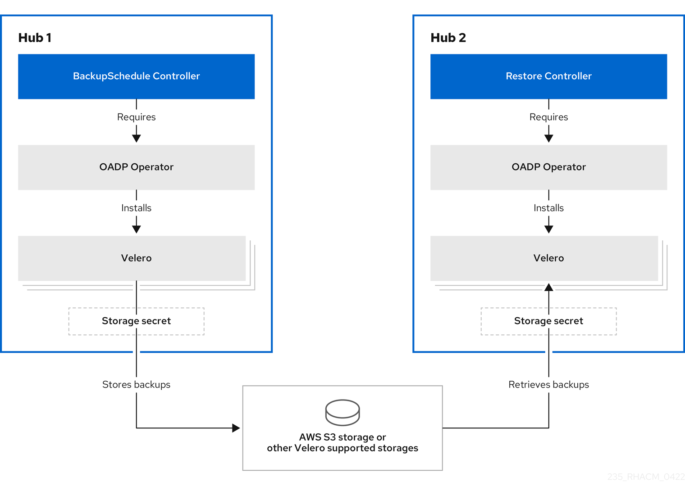

:_mod-docs-content-type: CONCEPT

[#backup-restore-architecture]
= View backup and restore architecture for {acm-short} hub clusters

[role="_abstract"]
The backup and restore operator manages the backup and restore processes for {acm-short} hub clusters. The operator implements the following custom resources:

* `BackupSchedule.cluster.open-cluster-management.io` to set up {acm-short} backup schedules.
* `restore.cluster.open-cluster-management.io` to process and restore these backups.

With the operator, you have Velero resources to define the options that you need to back up remote and hub cluster resources that need to be restored.

For a visual of this process, see the following architecture diagram:

The backup and restore component gives a set of policies for reporting issues. Use the policy templates to create an alert to the hub cluster administrator if the backup solution is not functioning.

The cluster backup and restore operator depends on the OADP Operator to install Velero, and to create a connection from the hub cluster to the backup storage location where the data is stored. Velero is the component that runs the backup and restore operations. The cluster backup and restore operator solution provides backup and restore support for all {acm-short} hub cluster resources, including managed clusters, applications, and policies.

.Additional resources

* xref:../backup_restore/backup_arch_resources.adoc#backed-up-resources[Review resources included and excluded by the backup feature]
* xref:../backup_restore/backup_arch_activation.adoc#backup-arch-activation[Review resources restored at managed cluster activation]
* xref:../backup_restore/backup_function.adoc#backup-function[Use the backup function]
* xref:../backup_restore/backup_validate.adoc#backup-validation-using-a-policy[Backup and restore configuration validation]
* link:https://docs.redhat.com/en/documentation/openshift_container_platform/5.0/html/backup_and_restore/oadp-application-backup-and-restore[OADP Operator]
