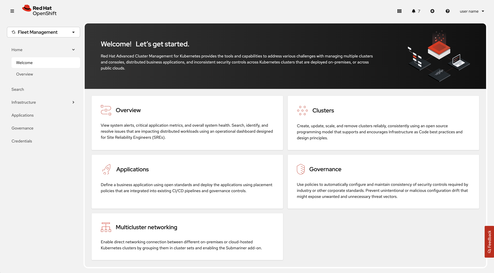

:_mod-docs-content-type: REFERENCE

[#web-console]
= Web console

[role="_abstract"]
Learn how to access and use components of the {acm} console. Learn more about console components that you can use to view, manage, or customize your console.

See the following image of the _Navigation_ from the {acm} console, which is described in more detail later in each section. See that the navigation represents major production function:

Home::
From the {acm} _Home_ page in the _Fleet Management_ perspective, you can access more information and you can search across the product. Click *Welcome* for more introductory information about each product function.
Infrastructure::
From _Clusters_, you can create new clusters or import existing clusters. From _Automation_, you can create an Ansible template.
Applications::
Create an application and edit a `.yaml` file. Access an overview or more advanced information about each application.
Governance::
Create and edit a `.yaml` file to create a policy. Use the _Governance_ dashboard to manage policies and policy controllers.
Credentials::
The credential stores the access information for a cloud provider. Each provider account requires its own credential, as does each domain on a single provider.
+
Review your credentials or add a credential.
